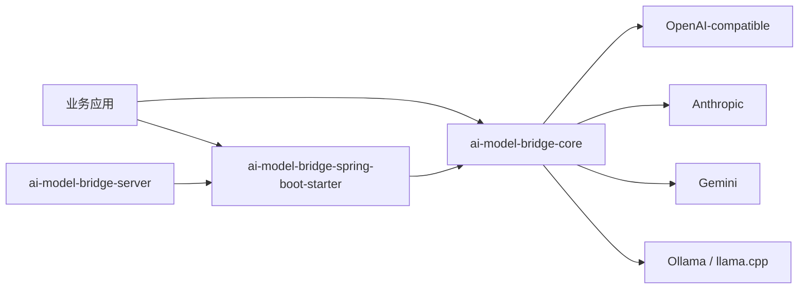
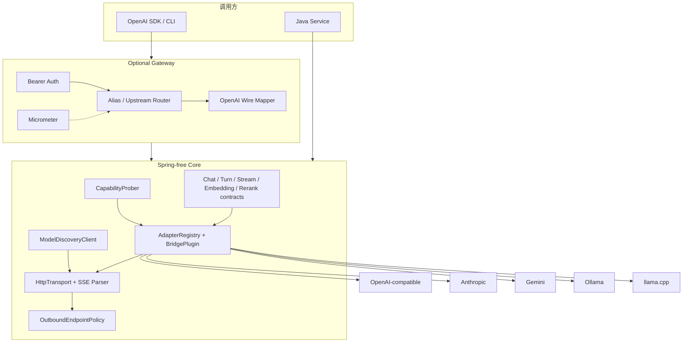
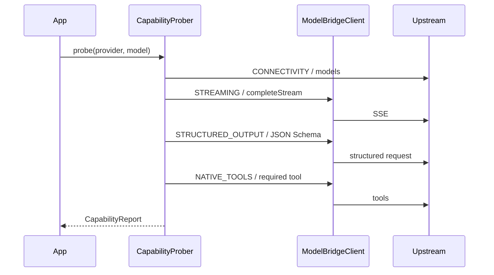

<div align="center">

# AI Model Bridge

### 统一模型协议、流式输出与工具调用的 Java 接入层

<p>
  <a href="https://github.com/BangShou1st/ai-model-bridge/actions/workflows/ci.yml">
    
  </a>
  <a href="https://jitpack.io/#BangShou1st/ai-model-bridge">
    
  </a>
  <a href="https://github.com/BangShou1st/ai-model-bridge/releases">
    
  </a>
  
  
  
  
</p>

<p>
  
  
  
  
  
</p>

<p>
  <b>一个 Spring-free 核心 + 一个 Spring Boot Starter + 一个可选 OpenAI 兼容网关</b><br />
  <sub>Chat · Native Tools · SSE · Structured Output · Embedding · Rerank · Discovery · Capability Probe</sub>
</p>

<p>
  <a href="#-为什么需要-ai-model-bridge">项目定位</a> ·
  <a href="#-模块结构">模块结构</a> ·
  <a href="#-架构">架构</a> ·
  <a href="#-快速开始">快速开始</a> ·
  <a href="#-可选网关">可选网关</a> ·
  <a href="#-安全模型">安全模型</a> ·
  <a href="#-测试与发布">测试与发布</a>
</p>

</div>

---

> [!TIP]
> **v0.1.0** 已提供 JitPack 多模块坐标。核心库零 Spring 依赖；Starter 同时面向 Spring Boot 3.4+ 与 4.x；Server 可直接作为 Magpie、OpenAI、Anthropic、Gemini、Ollama、llama.cpp 的统一接入面。

## 🌉 为什么需要 AI Model Bridge

接入多个模型供应商时，业务代码通常会被这些差异污染：

- OpenAI、Anthropic、Gemini 的消息结构、工具调用、流式事件和错误语义完全不同。
- `reasoning_effort`、`enable_thinking`、`thinkingBudget` 等参数散落在各家私有字段里。
- 结构化输出失败后缺少可控降级，超长输出又经常丢失已经产生的 usage。
- 模型目录只有 `id`，没有 context window、reasoning levels、tools、pricing 等决策信息。
- 自建网关容易在 SSRF、DNS rebinding、日志泄露和上游 429/504 处理上留下安全债务。
- 直接引入 Spring、数据库或业务概念，会让“模型接入层”无法被其他项目复用。

**AI Model Bridge** 把这些能力收敛为一套 Java 21 契约：

| 目标 | 实现 |
| --- | --- |
| 业务不感知供应商 | 统一 `ChatRequest`、`TurnRequest`、`StreamChunk`、`EmbeddingRequest`、`RerankRequest` |
| 协议可插拔 | `AdapterRegistry` + `BridgePlugin` SPI |
| 安全默认开启 | HTTPS 强校验、DNS 答案整体校验、私网/元数据拦截、受控 loopback 白名单 |
| 可观测且不泄密 | 统一错误分类、retryable、LENGTH usage、日志脱敏 |
| 可选而非强绑定 | Core 零 Spring；Starter 只做自动装配；Server 是完全独立进程 |

模型目录线格式参考 [Magpie](https://github.com/yetone/magpie) 的 `/v1/models` 实践，
包括 `context_window`、`max_output_tokens`、`reasoning_levels`、
`supported_parameters`、OpenRouter 风格 `pricing` 与 `native_endpoints`。
本项目不包含 Magpie 源码、OpenCode Zen、Kilo Gateway 或任何业务项目代码。

## 📦 模块结构



| 模块 | 关键内容 | 依赖边界 |
| --- | --- | --- |
| `ai-model-bridge-core` | 统一契约、四个协议适配器、模型发现、能力探针、安全、错误模型 | 仅 Jackson + SLF4J + JDK `HttpClient` |
| `ai-model-bridge-spring-boot-starter` | `@ConfigurationProperties("ai.bridge")`、环回守卫、`@ConditionalOnMissingBean` | 无数据库 / JPA / Flyway / User / Project |
| `ai-model-bridge-server` | `/v1/models`、Chat + SSE + tools、Embeddings、Rerank、别名路由、网关鉴权、Micrometer | 可选独立网关 |

要求：**Java 21+**、**Maven 3.9+**、消费端 **Spring Boot 3.4+ / 4.x**。

## 🧭 架构



### 四阶能力探针



## ✨ 能力矩阵

| 能力 | OpenAI-compatible | Anthropic | Gemini | Ollama | llama.cpp |
| :--- | :---: | :---: | :---: | :---: | :---: |
| Chat complete | ✅ | ✅ | ✅ | ✅ via OpenAI | — |
| SSE streaming | ✅ | ✅ | ✅ | ✅ via OpenAI | — |
| Native tools | ✅ | ✅ | ✅ | ✅ via OpenAI | — |
| Structured output | ✅ + fallback | ✅ prompt JSON | ✅ | ✅ prompt JSON | — |
| Embedding | ✅ | — | — | ✅ | — |
| Rerank | — | — | — | — | ✅ |
| Model discovery | ✅ + Magpie | ✅ | ✅ | ✅ | ✅ |

补充能力：

- **OpenAI-compatible**：`STRUCTURED_OUTPUT` 失败自动降级一次 `PROMPT_JSON`；白名单扩展参数 `enable_thinking` / `reasoning_effort`；`LENGTH` 异常携带 usage。
- **Anthropic**：`x-api-key` + `anthropic-version`，role 交替与 `tool_use` / `tool_result` 映射，流式工具参数分片。
- **Gemini**：`x-goog-api-key`，`thinkingConfig` 的 budget/level 受控覆盖，`toolCallId` 按请求作用域归一化。
- **Embedding**：OpenAI `/v1/embeddings`；Ollama `/api/embed` 与旧 `/api/embeddings` 兼容回退。
- **Rerank**：llama.cpp；上游 `top_n` 始终为候选全量，验证索引完整、唯一、分数有限，结果包含模型调用耗时。

## 🚀 快速开始

### JitPack

```xml
<repository>
    <id>jitpack.io</id>
    <url>https://jitpack.io</url>
</repository>
```

```groovy
repositories {
    mavenCentral()
    maven { url 'https://jitpack.io' }
}
```

```xml
<dependency>
    <groupId>com.github.BangShou1st.ai-model-bridge</groupId>
    <artifactId>ai-model-bridge-core</artifactId>
    <version>v0.1.0</version>
</dependency>
```

```groovy
implementation 'com.github.BangShou1st.ai-model-bridge:ai-model-bridge-core:v0.1.0'
implementation 'com.github.BangShou1st.ai-model-bridge:ai-model-bridge-spring-boot-starter:v0.1.0'
```

JitPack 构建日志：
**[v0.1.0 build.log](https://jitpack.io/com/github/BangShou1st/ai-model-bridge/v0.1.0/build.log)**

### 直接调用 Core

```java
ObjectMapper mapper = new ObjectMapper();
OutboundEndpointPolicy policy = OutboundEndpointPolicy.httpsOnly();
ModelBridgeClient client = ModelBridgeClient.create(mapper, policy);

ProviderConfig provider = ProviderConfig.openAiCompatible(
        "upstream",
        "https://api.example.com/v1",
        System.getenv("MODEL_API_KEY"));

ChatResponse response = client.complete(provider, ChatRequest.builder("model-id")
        .user("用一句话解释模型网关。")
        .temperature(0.2)
        .maxOutputTokens(512)
        .build());
```

流式：

```java
client.completeStream(provider, request, chunk -> {
    if (chunk.type() == StreamChunk.Type.CONTENT) {
        System.out.print(chunk.delta());
    }
});
```

原生工具调用：

```java
ToolDefinition tool = new ToolDefinition(
        "lookup_order",
        "查询订单状态",
        mapper.readTree("""
                {"type":"object","properties":{"orderId":{"type":"string"}},
                 "required":["orderId"]}
                """));

TurnRequest turn = new TurnRequest(
        "model-id",
        List.of(Message.user("查询订单 A-1001")),
        List.of(tool),
        ToolChoice.REQUIRED,
        0.0,
        512,
        ReasoningOptions.none(),
        Map.of(),
        "request-1");

TurnResult result = client.turn(provider, turn);
```

### Spring Boot Starter

```xml
<dependency>
    <groupId>com.github.BangShou1st.ai-model-bridge</groupId>
    <artifactId>ai-model-bridge-spring-boot-starter</artifactId>
    <version>v0.1.0</version>
</dependency>
```

自动装配 Bean：

```text
OutboundEndpointPolicy
HttpTransport
AdapterRegistry
ModelBridgeClient
ModelDiscoveryClient
CapabilityProber
```

全部使用 `@ConditionalOnMissingBean`，应用可以替换任意一个 Bean。

```yaml
ai:
  bridge:
    enabled: true
    connect-timeout: 10s
    request-timeout: 2m
    security:
      allow-loopback: true   # 仅 local/test profile
      loopback-hosts: [127.0.0.1, ::1, localhost]
      loopback-ports: [3425]
```

> [!WARNING]
> 环回白名单不是生产环境的通用 SSRF 豁免。默认拒绝所有 loopback；开启时必须同时配置 host 与 port，并且仅在 `local` / `test` profile 下允许，否则应用启动失败。

## 🛰️ 可选网关

Server 读取 `ai.bridge.gateway.*`，支持多上游、显式模型别名和全局别名：

```yaml
ai:
  bridge:
    security:
      allow-loopback: true
      loopback-hosts: [127.0.0.1, localhost]
      loopback-ports: [3425, 11434, 8080]
    gateway:
      auth-enabled: true
      api-keys:
        - ${AI_BRIDGE_GATEWAY_API_KEY}
      aliases:
        fast: magpie/workbuddy/hy4free
      upstreams:
        magpie:
          type: openai-compatible
          base-url: http://127.0.0.1:3425/v1
          api-key: ${MAGPIE_API_KEY:}
          models:
            - id: workbuddy/hy4free
              alias: hy4
              display-name: Hy4
              context-window: 960000
              max-input-tokens: 960000
              max-output-tokens: 64000
              supports-tools: true
              supports-reasoning: true
              reasoning-levels: [high]
              supported-parameters: [tools, tool_choice, reasoning]
              pricing:
                prompt: 0
                completion: 0
              native-endpoints:
                - /v1/chat/completions
        ollama:
          type: ollama
          base-url: http://127.0.0.1:11434
          models:
            - id: nomic-embed-text
              alias: embeddings
        local-rerank:
          type: llama-cpp
          base-url: http://127.0.0.1:8080
          models:
            - id: bge-reranker-v2-m3
              alias: rerank
```

启动：

```powershell
$env:AI_BRIDGE_GATEWAY_API_KEY = "dev-secret"
java -jar ai-model-bridge-server/target/ai-model-bridge-server-0.1.0.jar --spring.profiles.active=local
```

### API Surface

| Method | Path | 说明 |
| :--- | :--- | :--- |
| `GET` | `/v1/models` | OpenAI / Magpie 风格丰富模型目录 |
| `POST` | `/v1/chat/completions` | Chat、`stream=true` SSE、native tools |
| `POST` | `/v1/embeddings` | OpenAI-compatible / Ollama |
| `POST` | `/v1/rerank` | llama.cpp，结果携带耗时 |
| `GET` | `/actuator/health` | 健康检查 |
| `GET` | `/actuator/metrics` | Micrometer 指标 |

```bash
curl http://127.0.0.1:8080/v1/models \
  -H 'Authorization: Bearer dev-secret'

curl http://127.0.0.1:8080/v1/chat/completions \
  -H 'Authorization: Bearer dev-secret' \
  -H 'Content-Type: application/json' \
  -d '{"model":"fast","stream":true,"messages":[{"role":"user","content":"hello"}]}'
```

网关保证：

- 请求模型名可以是显式别名、全局别名或唯一模型 ID；发往上游时替换为真实模型 ID。
- SSE 输出标准 `chat.completion.chunk`，支持 content、reasoning_content、tool_calls 分片和 usage。
- 虚拟网关使用 Bearer token 鉴权，认证失败不访问上游。
- `ai.bridge.gateway.latency` 与 `ai.bridge.gateway.errors` 带 endpoint/provider/category 标签。

### 模型元数据形态

```json
{
  "id": "hy4",
  "object": "model",
  "display_name": "Hy4",
  "context_window": 960000,
  "max_output_tokens": 64000,
  "supports_tools": true,
  "supports_reasoning": true,
  "reasoning_levels": ["high"],
  "supported_parameters": ["tools", "tool_choice", "reasoning"],
  "pricing": {
    "prompt": "0",
    "completion": "0"
  },
  "native_endpoints": ["/v1/chat/completions"]
}
```

## 🔐 安全模型

| 边界 | 行为 |
| --- | --- |
| 公网 endpoint | 只允许 HTTPS；禁止 userinfo、fragment 与自动重定向 |
| DNS | 解析结果整体校验；任何私网、链路本地、CGNAT、云元数据或 mixed public/private 答案都拒绝 |
| 环回 | 默认拒绝；显式 host + port 白名单；Starter 仅允许 `local` / `test` |
| 日志 | 不打印 API Key、Authorization、Prompt 正文；只记录模型、消息数、字符数、状态、分类 |
| 错误 | 上游响应正文不进入异常消息；统一映射为稳定分类 |

### 错误分类

| Category | 常见来源 | retryable |
| :--- | :--- | :---: |
| `AUTHENTICATION` | 401 | ❌ |
| `AUTHORIZATION` | 403 | ❌ |
| `RATE_LIMIT` | 429 | ✅ |
| `UNAVAILABLE` | 5xx / 网络失败 | ✅ |
| `TIMEOUT` | 408 / 504 / 本地超时 | ✅ |
| `LENGTH` | `finish_reason=length` / `max_tokens` | ❌ |
| `SCHEMA` | structured output / rerank 完整性失败 | ❌ |
| `INVALID_RESPONSE` | 非法上游 JSON / SSE / 工具参数 | ❌ |
| `NETWORK_POLICY` | SSRF / DNS rebinding / 非白名单环回 | ❌ |

`LENGTH` 异常通过 `usage()` 携带已经产生的 token 用量。

## 🧪 测试与发布

```bash
./mvnw -B -ntp verify
```

测试矩阵：

| 范围 | 覆盖 |
| --- | --- |
| Core | 40 tests：三协议转换、SSE 分片、structured fallback、LENGTH usage、SSRF、模型发现、探针、日志脱敏 |
| Starter | 12 tests：自动装配、属性绑定、Bean 覆盖、环回白名单、非 local/test 启动拒绝 |
| Server | 8 tests：鉴权、别名路由、SSE、tools、embeddings、rerank、429/504、Micrometer |

测试全部使用真实本地 `com.sun.net.httpserver.HttpServer`，不使用假响应或跳过测试。

Release 流程：

```bash
git tag -a v0.1.0 -m "ai-model-bridge v0.1.0"
git push origin v0.1.0
```

JitPack 多模块坐标：

```text
com.github.BangShou1st.ai-model-bridge:ai-model-bridge-core:v0.1.0
com.github.BangShou1st.ai-model-bridge:ai-model-bridge-spring-boot-starter:v0.1.0
com.github.BangShou1st.ai-model-bridge:ai-model-bridge-server:v0.1.0
```

## 🗺️ 兼容与范围

- Core 不引入 Spring，可在普通 Java、Quarkus、Micronaut 或已有 Spring 应用中使用。
- Starter 以 Spring Boot 3.4.5 编译，并保持 Boot 4.x 自动装配方式兼容。
- Server 定位是**通用可选网关**，不承担账号、租户、计费、业务数据库或审批流。
- 当前优先支持文本、SSE、tools、embedding、rerank；图片/音频/视频的完整多模态映射不在 v0.1.0 范围。

## 🙏 参考与致谢

- [Magpie](https://github.com/yetone/magpie)：`/v1/models` 丰富元数据、OpenAI 兼容网关形态与路由思路参考。
- [OpenAI API](https://platform.openai.com/docs/api-reference)、[Anthropic Messages API](https://docs.anthropic.com/)、[Google Gemini API](https://ai.google.dev/)：协议语义参考。
- [llama.cpp](https://github.com/ggml-org/llama.cpp)、[Ollama](https://github.com/ollama/ollama)：Embedding / Rerank 接口参考。

本项目只借鉴公开协议与接口形态，不复制参考仓库的业务代码或内部实现。

## 📄 License

[Apache License 2.0](LICENSE)

<div align="center">

**如果这个项目对你有帮助，欢迎 Star ⭐**

</div>
