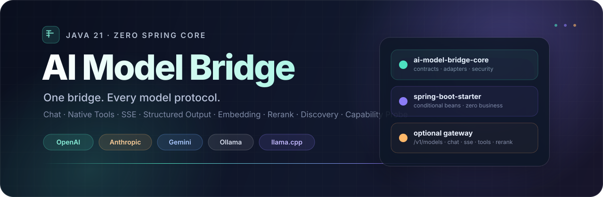
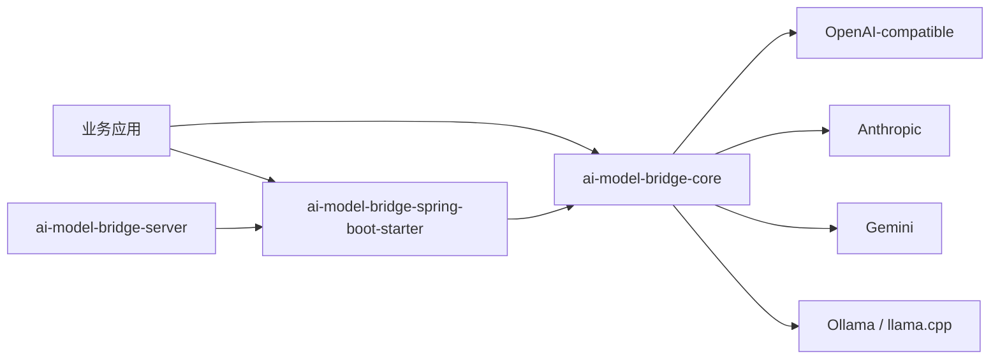
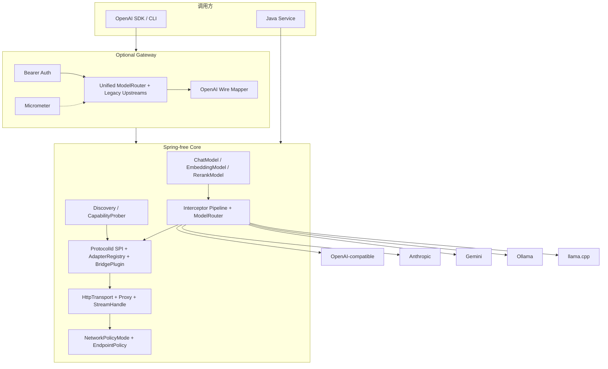
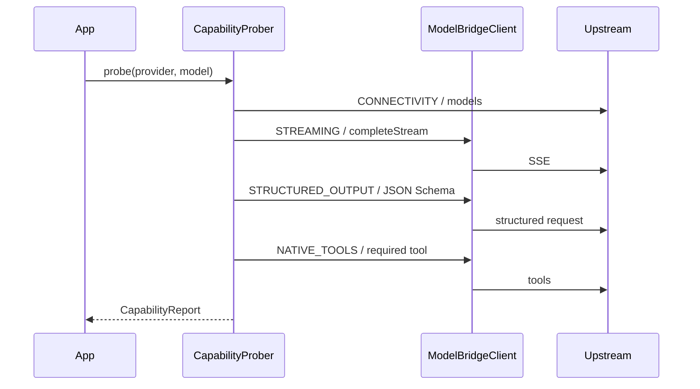

<div align="center">



# AI Model Bridge

### 统一模型协议、流式输出与工具调用的 Java 接入层

<p>
  <a href="https://github.com/BangShou1st/ai-model-bridge/actions/workflows/ci.yml">
    
  </a>
  <a href="https://jitpack.io/#BangShou1st/ai-model-bridge">
    
  </a>
  <a href="https://github.com/BangShou1st/ai-model-bridge/releases">
    
  </a>
  
  
  
  
</p>

<p>
  
  
  
  
  
</p>

<p>
  <b>一个 Spring-free 核心 + 一个 Spring Boot Starter + 一个可选 OpenAI 兼容网关</b><br />
  <sub>Chat · Native Tools · SSE · Structured Output · Embedding · Rerank · Discovery · Capability Probe</sub>
</p>

<p>
  <a href="#-为什么需要-ai-model-bridge">项目定位</a> ·
  <a href="#-模块结构">模块结构</a> ·
  <a href="#-架构">架构</a> ·
  <a href="#-快速开始">快速开始</a> ·
  <a href="#-可选网关">可选网关</a> ·
  <a href="#-安全模型">安全模型</a> ·
  <a href="#-测试与发布">测试与发布</a>
</p>

</div>

---

> [!TIP]
> **v0.2.0** 已完成框架化升级：开放协议 SPI、声明式 `ModelRouter`、`ChatModel` / `EmbeddingModel` / `RerankModel`、可取消流、统一拦截器管道。核心库仍保持零 Spring 依赖，Starter 同时面向 Spring Boot 3.4+ 与 4.x。

## 🌉 为什么需要 AI Model Bridge

接入多个模型供应商时，业务代码通常会被这些差异污染：

- OpenAI、Anthropic、Gemini 的消息结构、工具调用、流式事件和错误语义完全不同。
- `reasoning_effort`、`enable_thinking`、`thinkingBudget` 等参数散落在各家私有字段里。
- 结构化输出失败后缺少可控降级，超长输出又经常丢失已经产生的 usage。
- 模型目录只有 `id`，没有 context window、reasoning levels、tools、pricing 等决策信息。
- 自建网关容易在 SSRF、DNS rebinding、日志泄露和上游 429/504 处理上留下安全债务。
- 直接引入 Spring、数据库或业务概念，会让“模型接入层”无法被其他项目复用。

**AI Model Bridge** 把这些能力收敛为一套 Java 21 契约：

| 目标 | 实现 |
| --- | --- |
| 业务不感知供应商 | 统一 `ChatModel`、`EmbeddingModel`、`RerankModel`、`ChatRequest`、`ContentPart`、`StreamHandle` |
| 协议可插拔 | 开放 `ProtocolId`、`AdapterRegistry`、`ModelDiscoveryAdapter` 与 `BridgePlugin` SPI |
| 极低接入门槛 | YAML 声明 Provider / Model / 参数继承 / Alias Fallback，注入即用 |
| 安全默认开启 | HTTPS 强校验、DNS 答案整体校验、私网/元数据拦截、三级网络策略预设 |
| 可观测且不泄密 | 统一错误分类、retryable、LENGTH usage、日志脱敏 |
| 可选而非强绑定 | Core 零 Spring；Starter 只做自动装配；Server 是完全独立进程 |

模型目录线格式参考 [Magpie](https://github.com/yetone/magpie) 的 `/v1/models` 实践，
包括 `context_window`、`max_output_tokens`、`reasoning_levels`、
`supported_parameters`、OpenRouter 风格 `pricing` 与 `native_endpoints`。
本项目不包含任何商业网关或业务项目代码。

## 📦 模块结构



| 模块 | 关键内容 | 依赖边界 |
| --- | --- | --- |
| `ai-model-bridge-core` | 统一模型实例、拦截器管道、开放 SPI、发现/Embedding/Rerank 拆分适配器、安全与传输 | 仅 Jackson + SLF4J + JDK `HttpClient` |
| `ai-model-bridge-spring-boot-starter` | `ai.bridge.*` YAML、`BridgeConfig`、`ModelRouter`、默认模型自动装配 | 无数据库 / JPA / Flyway / User / Tenant |
| `ai-model-bridge-server` | 复用 `ModelRouter` 的 `/v1/models`、Chat + SSE、Embeddings、Rerank、旧配置兼容 | 可选独立网关 |

要求：**Java 21+**、**Maven 3.9+**、消费端 **Spring Boot 3.4+ / 4.x**。

## 🧭 架构



### 四阶能力探针



## ✨ 能力矩阵

| 能力 | OpenAI-compatible | Anthropic | Gemini | Ollama | llama.cpp |
| :--- | :---: | :---: | :---: | :---: | :---: |
| Chat complete | ✅ | ✅ | ✅ | ✅ via OpenAI | — |
| SSE streaming | ✅ | ✅ | ✅ | ✅ via OpenAI | — |
| Native tools | ✅ | ✅ | ✅ | ✅ via OpenAI | — |
| Structured output | ✅ + fallback | ✅ + fallback | ✅ + fallback | ✅ prompt JSON | — |
| Embedding | ✅ | — | ✅ | ✅ | — |
| Rerank | — | — | — | — | ✅ |
| Model discovery | ✅ + rich metadata | ✅ | ✅ | ✅ | ✅ |
| Custom protocol SPI | ✅ | ✅ | ✅ | ✅ | ✅ |

补充能力：

- **统一语义**：结构化输出校验与单次 `PROMPT_JSON` 降级、截断策略、重试、日志脱敏都在同一 `ChatInterceptor` 管道执行。
- **OpenAI-compatible**：`top_p` / `stop` / `seed` / penalties / reasoning 与安全 `extraBody` 透传；流尾完整 usage 保留。
- **Anthropic**：`x-api-key`、`thinking` budget、thinking signature 多轮回传、图片 block、Prompt JSON。
- **Gemini**：`thinkingConfig`、`thoughtSignature`、`inlineData` / `fileData`，OpenAI 风格 tool 消息自动回填函数名。
- **Embedding**：独立 OpenAI / Gemini / Ollama 适配器；Gateway 不再按枚举硬编码拦截。
- **Rerank**：llama.cpp；验证索引完整、唯一、分数有限，结果包含模型调用耗时。
- **截断**：协议层默认把 `LENGTH` 当作正常终止原因；只有 `failOnLength=true` 的 `TruncationPolicyInterceptor` 才抛携带完整 usage 的异常。

## 🚀 快速开始

### JitPack

```xml
<repository>
    <id>jitpack.io</id>
    <url>https://jitpack.io</url>
</repository>
```

```groovy
repositories {
    mavenCentral()
    maven { url 'https://jitpack.io' }
}
```

```xml
<dependency>
    <groupId>com.github.BangShou1st.ai-model-bridge</groupId>
    <artifactId>ai-model-bridge-core</artifactId>
    <version>v0.2.0</version>
</dependency>
```

```groovy
implementation 'com.github.BangShou1st.ai-model-bridge:ai-model-bridge-core:v0.2.0'
implementation 'com.github.BangShou1st.ai-model-bridge:ai-model-bridge-spring-boot-starter:v0.2.0'
```

JitPack 构建日志：
**[v0.2.0 build.log](https://jitpack.io/com/github/BangShou1st/ai-model-bridge/v0.2.0/build.log)**

### 直接调用 Core

```java
ObjectMapper mapper = new ObjectMapper();
OutboundEndpointPolicy policy = OutboundEndpointPolicy.httpsOnly();
ModelBridgeClient client = ModelBridgeClient.create(mapper, policy);

ProviderConfig provider = ProviderConfig.openAiCompatible(
        "upstream",
        "https://api.example.com/v1",
        System.getenv("MODEL_API_KEY"));

ChatResponse response = client.complete(provider, ChatRequest.builder("model-id")
        .user("用一句话解释模型网关。")
        .options(ChatOptions.builder()
                .temperature(0.2)
                .maxOutputTokens(512)
                .failOnLength(false)
                .build())
        .build());
```

绑定模型实例与可取消流：

```java
ChatModel model = new DefaultChatModel(
        "model-id", provider, client,
        List.of(new LoggingInterceptor(),
                new RetryInterceptor(RetryPolicy.of(3)),
                new StructuredOutputInterceptor(mapper),
                new TruncationPolicyInterceptor()),
        ChatOptions.defaults());

StreamHandle handle = model.stream(request, chunk -> {
    if (chunk.type() == StreamChunk.Type.CONTENT) {
        System.out.print(chunk.delta());
    }
});

// 客户端断开或用户取消时立即关闭上游连接
handle.cancel();
handle.await();
```

`ModelBridgeClient` 仍保留兼容方法 `completeStream(provider, request, Consumer)`；
新代码建议使用 `openStream(...)` 或 `ChatModel.stream(...)` 获取 `StreamHandle`。

原生工具调用（`TurnRequest` 已标记 `@Deprecated`，内部统一转换为 `ChatRequest`）：

```java
ToolDefinition tool = new ToolDefinition(
        "lookup_order",
        "查询订单状态",
        mapper.readTree("""
                {"type":"object","properties":{"orderId":{"type":"string"}},
                 "required":["orderId"]}
                """));

TurnRequest turn = new TurnRequest(
        "model-id",
        List.of(Message.user("查询订单 A-1001")),
        List.of(tool),
        ToolChoice.REQUIRED,
        0.0,
        512,
        ReasoningOptions.none(),
        Map.of(),
        "request-1");

TurnResult result = client.turn(provider, turn);
```

### Spring Boot Starter

```xml
<dependency>
    <groupId>com.github.BangShou1st.ai-model-bridge</groupId>
    <artifactId>ai-model-bridge-spring-boot-starter</artifactId>
    <version>v0.2.0</version>
</dependency>
```

自动装配 Bean：

```text
OutboundEndpointPolicy
HttpTransport
AdapterRegistry
ModelBridgeClient
ModelDiscoveryClient
CapabilityProber
ModelRouter
ChatModel            # 配置 default-chat-model 时
EmbeddingModel       # 配置 default-embedding-model 时
RerankModel          # 配置 default-rerank-model 时
```

全部使用 `@ConditionalOnMissingBean`，应用可以替换任意一个 Bean。

<!-- readme-main-example:start -->
```yaml
ai:
  bridge:
    enabled: true
    default-chat-model: smart
    connect-timeout: 10s
    request-timeout: 2m

    defaults:
      temperature: 0.2
      max-output-tokens: 2048
      fail-on-length: false
      retry:
        max-attempts: 3
        initial-backoff: 500ms
        max-backoff: 10s
        respect-retry-after: true
      proxy:
        enabled: false
        host: 127.0.0.1
        port: 7890

    security:
      mode: public-https-only   # public-https-only | allow-loopback | allow-private-network
      allow-loopback: false
      allow-loopback-in-production: false
      loopback-hosts: [127.0.0.1, "::1", localhost]
      loopback-ports: []

    providers:
      deepseek:
        protocol: openai-compatible
        base-url: https://api.deepseek.com
        api-key: ${DEEPSEEK_API_KEY:}
        endpoints:
          chat-path: /chat/completions
          models-path: /models
        defaults:
          max-output-tokens: 4096
        models:
          - id: deepseek-chat
            alias: ds
            display-name: DeepSeek Chat
            supports-tools: true

      gemini:
        protocol: gemini
        base-url: https://generativelanguage.googleapis.com
        api-key: ${GEMINI_API_KEY:}
        models:
          - id: gemini-2.5-flash
            alias: fast
            supports-tools: true
            supports-reasoning: true

    aliases:
      smart:
        - deepseek/deepseek-chat
        - gemini/gemini-2.5-flash
```
<!-- readme-main-example:end -->

参数按 `全局 defaults -> Provider defaults -> Model defaults -> 单次 ChatRequest.options`
逐级覆盖；`aliases` 是有序候选列表，遇到 `RATE_LIMIT` / `UNAVAILABLE` / `TIMEOUT`
会自动切换到下一模型，流式仅允许在首个内容 chunk 之前切换。

Embedding、Rerank 和本地模型属于可选能力，按需单独声明；不需要时不要配置对应的
`default-embedding-model` / `default-rerank-model`：

```yaml
ai:
  bridge:
    default-embedding-model: gemini/gemini-embedding-001
    default-rerank-model: local-rerank/local-rerank-model
    security:
      mode: allow-loopback
      allow-loopback: true
      loopback-hosts: [127.0.0.1, localhost]
      loopback-ports: [8080, 11434]
    providers:
      gemini:
        protocol: gemini
        base-url: https://generativelanguage.googleapis.com
        api-key: ${GEMINI_API_KEY:}
        models:
          - id: gemini-embedding-001
            alias: embed
            supports-embeddings: true

      local-rerank:
        protocol: llama-cpp
        base-url: http://127.0.0.1:8080
        models:
          - id: local-rerank-model
            alias: rerank
            supports-rerank: true

      ollama-local:
        protocol: ollama
        base-url: http://127.0.0.1:11434
        discover-models: true
```

`provider/model` 指向真实模型 ID；模型级 `alias` 是便于直接调用的短名，不能再写成
`provider/alias`。同名模型跨 Provider 冲突时，目录会同时返回
`provider/model` 形式的可路由 ID。全局别名或模型级别名如果占用完整
`provider/model` 引用，必须单目标指向同一个模型；指向其他模型或包含多个候选会在
启动时失败。

> [!WARNING]
> `public-https-only` 是默认安全模式。`allow-loopback` 仍需显式 host + port 白名单，
> 生产 profile 默认禁止；确需生产本机模型时显式设置
> `allow-loopback-in-production=true`。`allow-private-network` 用于 Docker/K8s/企业内网，
> 但云元数据地址在所有模式下都强制拦截。

## 🛰️ 可选网关

Server 的调用、目录与 Fallback 已统一走 `ModelRouter`。推荐使用上面的
`ai.bridge.providers.*` / `ai.bridge.aliases.*`；原有 `ai.bridge.gateway.upstreams.*`
仍会被合并适配，便于 v0.1.x 配置无痛升级：

```yaml
ai:
  bridge:
    security:
      allow-loopback: true
      loopback-hosts: [127.0.0.1, localhost]
      loopback-ports: [18080, 11434, 8080]
    gateway:
      auth-enabled: true
      api-keys:
        - ${AI_BRIDGE_GATEWAY_API_KEY}
      aliases:
        fast: local-openai/vendor/chat-model
      upstreams:
        local-openai:
          type: openai-compatible
          base-url: http://127.0.0.1:18080/v1
          api-key: ${LOCAL_MODEL_API_KEY:}
          models:
            - id: vendor/chat-model
              alias: chat
              display-name: Vendor Chat
              context-window: 128000
              max-input-tokens: 128000
              max-output-tokens: 8192
              supports-tools: true
              supports-reasoning: true
              reasoning-levels: [medium]
              supported-parameters: [tools, tool_choice, reasoning]
              pricing:
                prompt: 0
                completion: 0
              native-endpoints:
                - /v1/chat/completions
        ollama:
          type: ollama
          base-url: http://127.0.0.1:11434
          models:
            - id: nomic-embed-text
              alias: embeddings
              supports-embeddings: true
              supports-streaming: false
        local-rerank:
          type: llama-cpp
          base-url: http://127.0.0.1:8080
          models:
            - id: bge-reranker-v2-m3
              alias: rerank
              supports-rerank: true
              supports-streaming: false
```

启动：

```powershell
$env:AI_BRIDGE_GATEWAY_API_KEY = "dev-secret"
java -jar ai-model-bridge-server/target/ai-model-bridge-server-0.2.0.jar --spring.profiles.active=local
```

### API Surface

| Method | Path | 说明 |
| :--- | :--- | :--- |
| `GET` | `/v1/models` | OpenAI 风格丰富模型目录 |
| `POST` | `/v1/chat/completions` | Chat、`stream=true` SSE、native tools |
| `POST` | `/v1/embeddings` | OpenAI-compatible / Gemini / Ollama / 插件协议 |
| `POST` | `/v1/rerank` | llama.cpp，结果携带耗时 |
| `GET` | `/actuator/health` | 健康检查 |
| `GET` | `/actuator/metrics` | Micrometer 指标 |

```bash
curl http://127.0.0.1:8080/v1/models \
  -H 'Authorization: Bearer dev-secret'

curl http://127.0.0.1:8080/v1/chat/completions \
  -H 'Authorization: Bearer dev-secret' \
  -H 'Content-Type: application/json' \
  -d '{"model":"fast","stream":true,"messages":[{"role":"user","content":"hello"}]}'
```

网关保证：

- 请求模型名可以是显式别名、全局别名或唯一模型 ID；发往上游时替换为真实模型 ID。
- 同名模型在目录中使用 `provider/model`，直接传歧义裸 ID 会返回带修复提示的错误。
- 同名 Provider 同时存在于新旧配置时，以 `ai.bridge.providers.*` 为准。
- SSE 输出标准 `chat.completion.chunk`，支持 content、reasoning_content、tool_calls 分片和 usage。
- 客户端取消 SSE 会通过 `StreamHandle` 立即关闭上游流。
- 虚拟网关使用 Bearer token 鉴权，认证失败不访问上游。
- `ai.bridge.gateway.latency` 与 `ai.bridge.gateway.errors` 带 endpoint/provider/category 标签。

### 模型元数据形态

```json
{
  "id": "vendor/chat-model",
  "object": "model",
  "display_name": "Vendor Chat",
  "context_window": 128000,
  "max_output_tokens": 8192,
  "supports_tools": true,
  "supports_reasoning": true,
  "supports_embeddings": false,
  "supports_rerank": false,
  "reasoning_levels": ["medium"],
  "supported_parameters": ["tools", "tool_choice", "reasoning"],
  "pricing": {
    "prompt": "0",
    "completion": "0"
  },
  "native_endpoints": ["/v1/chat/completions"]
}
```

## 🔐 安全模型

| 边界 | 行为 |
| --- | --- |
| 公网 endpoint | `PUBLIC_HTTPS_ONLY` 只允许 HTTPS；禁止 userinfo、fragment 与自动重定向 |
| DNS | 解析结果整体校验；公网模式拒绝私网、链路本地、CGNAT 与 mixed public/private 答案 |
| 环回 | 默认拒绝；显式 host + port 白名单；生产 profile 需额外显式开关 |
| 私网 | `ALLOW_PRIVATE_NETWORK` 允许 Docker/K8s/企业内网 HTTP(S)，但仍拒绝混合 loopback 答案 |
| 云元数据 | `169.254.169.254`、`100.100.100.200`、`168.63.129.16`、`fd00:ec2::254`、metadata 主机名在所有模式强制拦截 |
| 日志 | 不打印 API Key、Authorization、Prompt 正文；只记录模型、消息数、字符数、状态、分类 |
| 错误 | 上游响应正文不进入异常消息；统一映射为稳定分类 |

### 错误分类

| Category | 常见来源 | retryable |
| :--- | :--- | :---: |
| `AUTHENTICATION` | 401 | ❌ |
| `AUTHORIZATION` | 403 | ❌ |
| `RATE_LIMIT` | 429 | ✅ |
| `UNAVAILABLE` | 5xx / 网络失败 | ✅ |
| `TIMEOUT` | 408 / 504 / 本地超时 | ✅ |
| `LENGTH` | `finish_reason=length` / `max_tokens` | ❌ |
| `SCHEMA` | structured output / rerank 完整性失败 | ❌ |
| `INVALID_RESPONSE` | 非法上游 JSON / SSE / 工具参数 | ❌ |
| `NETWORK_POLICY` | SSRF / DNS rebinding / 非白名单环回 | ❌ |

注意：协议适配器默认把 `LENGTH` 作为正常终止原因返回，以保留完整文本与 usage。
只有显式启用 `TruncationPolicyInterceptor(true)` 或请求 `failOnLength=true` 时才会
抛出 `LENGTH` 异常，异常中的 `usage()` 已包含流尾完整用量。

## 🧪 测试与发布

```bash
./mvnw -B -ntp verify
```

测试矩阵：

| 范围 | 覆盖 |
| --- | --- |
| Core | 69 tests：三协议、统一 structured fallback、自定义 Plugin SPI、Retry-After、两阶段流式取消、目录冲突与别名占位校验、LENGTH usage、SSRF、发现与多模态 |
| Starter | 19 tests：README 主示例、YAML 绑定、参数继承、Alias Fallback、动态发现合并、代理注入、安全策略 |
| Server | 14 tests：鉴权、统一 Router、旧 upstreams 兼容、SSE 取消、Gemini Embedding、同名模型目录路由、429/504、Micrometer |

测试全部使用真实本地 `com.sun.net.httpserver.HttpServer`，不使用假响应或跳过测试。

Release 流程：

```bash
git tag -a v0.2.0 -m "ai-model-bridge v0.2.0"
git push origin v0.2.0
```

JitPack 多模块坐标：

```text
com.github.BangShou1st.ai-model-bridge:ai-model-bridge-core:v0.2.0
com.github.BangShou1st.ai-model-bridge:ai-model-bridge-spring-boot-starter:v0.2.0
com.github.BangShou1st.ai-model-bridge:ai-model-bridge-server:v0.2.0
```

## 🗺️ 兼容与范围

- Core 不引入 Spring，可在普通 Java、Quarkus、Micronaut 或已有 Spring 应用中使用。
- Starter 以 Spring Boot 3.4.5 编译，并保持 Boot 4.x 自动装配方式兼容。
- Server 定位是**通用可选网关**，不承担账号、租户、计费、业务数据库或审批流。
- v0.2.0 已支持文本图片多模态输入（OpenAI `image_url`、Anthropic `image`、Gemini `inlineData` / `fileData`）与 thinking signature 回传；音频/视频仍未纳入稳定契约。

## 🙏 参考与致谢

- [Magpie](https://github.com/yetone/magpie)：`/v1/models` 丰富元数据、OpenAI 兼容网关形态与路由思路参考。
- [OpenAI API](https://platform.openai.com/docs/api-reference)、[Anthropic Messages API](https://docs.anthropic.com/)、[Google Gemini API](https://ai.google.dev/)：协议语义参考。
- [llama.cpp](https://github.com/ggml-org/llama.cpp)、[Ollama](https://github.com/ollama/ollama)：Embedding / Rerank 接口参考。

本项目只借鉴公开协议与接口形态，不复制参考仓库的业务代码或内部实现。

## 📄 License

[Apache License 2.0](LICENSE)

<div align="center">

**如果这个项目对你有帮助，欢迎 Star ⭐**

</div>
